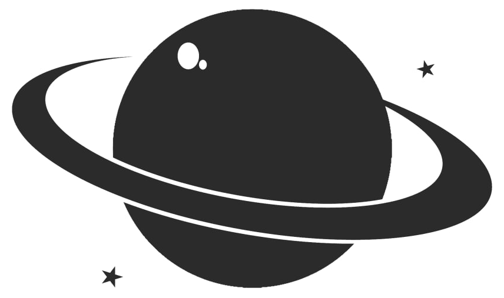
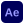

  <picture>
    <source media="(prefers-color-scheme: dark)" srcset="assets/planet-spin-dark.gif">
    
  </picture>

<h1 align="center">Med Amine Nehdi</h1>

Full-stack developer and designer. Industrial engineering student.

  <a href="https://www.linkedin.com/in/aminenehdi/">LinkedIn</a> ·
  <a href="https://discord.gg/NMRgaSQVNx">Discord</a>

#### Projects

| Project | What it does |
| ------- | ------------ |
| [UNIVERSAL-CONVERTER](https://github.com/amyyne01/UNIVERSAL-CONVERTER-) | Paste a link, get the file. YouTube, Spotify, SoundCloud and short-form video in one window. Electron, React, TypeScript. |
| [ahg-studio](https://github.com/sinfoo/ahg-studio) | Premium screen recorder, video optimizer and multi-track editor. Electron, React, FFmpeg. Collaborator. |

#### Design

Logos, identities, video and motion.

  
  
  
  
  

#### Code

  
  
  
  
  
  
  
  
  
  

