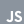

### Hey!

I'm **Med Amine Nehdi**.

I build full-stack apps and the infrastructure under them, and I design: brand, graphics, motion.

Right now: **AHG Universal Converter**, a desktop media downloader.

 
 
 

#### Projects

| Project | What it does |
| ------- | ------------ |
| [UNIVERSAL-CONVERTER](https://github.com/amyyne01/UNIVERSAL-CONVERTER-) | Paste a link, get the file. YouTube, Spotify, SoundCloud and short-form video in one window. Electron, React, TypeScript. |

#### Design

Brand, graphics and motion work: logos, identities, video and animation.

  &nbsp;&nbsp;
  &nbsp;&nbsp;
  &nbsp;&nbsp;
  &nbsp;&nbsp;
  &nbsp;&nbsp;

#### Code

  &nbsp;&nbsp;
  &nbsp;&nbsp;
  &nbsp;&nbsp;
  &nbsp;&nbsp;
  &nbsp;&nbsp;
  &nbsp;&nbsp;
  &nbsp;&nbsp;
  &nbsp;&nbsp;
  &nbsp;&nbsp;
  &nbsp;&nbsp;

#### Contact

[Discord](https://discord.gg/NMRgaSQVNx)
